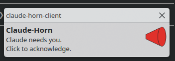

# Claude-Horn

When an agent needs you and you're not looking, it toots a horn. If you still
don't answer, it gets a louder horn and tries your other computer.



A stripped-down successor to [Claude-PA](https://github.com/danielrosehill/Claude-PA):
no Home Assistant cascade, no phone calls. Horns, bugles and Herman Poppleberry over MQTT, plus
optional spoken messages synthesised on the client.

```
agent ──HTTP──▶ horn server (home server, Docker) ──MQTT──▶ tray client on each machine ──▶ 🔊
                      ▲                                            │
                      └──────────────── ack (you clicked) ─────────┘
```

## Parts

| Part | Where it runs | What it does |
|---|---|---|
| `server/` | Home server, Docker | HTTP API → MQTT. Runs the escalation ladder; stops when any client acks. Python stdlib + `paho-mqtt`. |
| `client/` | Each desktop/laptop | Tray icon (PySide6). On/off toggle, plays horns, notification with click-to-acknowledge. **On by default, autostarts at login.** |
| `tools/horn` | Wherever the agent runs | `curl` wrapper the agent calls. |
| `sounds/` | Shipped to clients | `horns/`, `bugles/`, `herman/` and `chaos/` MP3s. |

Needs an MQTT broker that the server and the clients can all reach (Mosquitto, or the one Home Assistant already runs).

## Horns

| Name | Source |
|---|---|
| `bugle` | Synthesised ("Charge!") by `tools/synth-horns.py` |
| `air-horn` | Synthesised (three-blast stadium horn) by `tools/synth-horns.py` |
| `car-horn`, `car-horn-long`, `ship-horn`, `siren` | From Claude-PA's `soundfx/` (Pixabay) |

### Bugles (`sounds/bugles/`)

`bugle-reveille`, `bugle-call-to-post`, `bugle-mess-call`, `bugle-taps`: traditional bugle calls (public-domain melodies), synthesised by `tools/synth-horns.py` as recognisable approximations. Send `horn: "bugles"` to get a random one (the `bugle` charge included).

### Herman Poppleberry (`sounds/herman/`)

Prerecorded lines in the voice of Herman Poppleberry, the donkey co-host of [My Weird Prompts](https://myweirdprompts.com). Rendered once (2026-11-09) with the podcast's production Chatterbox voice clone on a GPU; the texts are in `sounds/herman/lines.json`. Send `horn: "herman"` to get a random one, or name one:

| Name | Line |
|---|---|
| `herman-need-you` | Hey Daniel! Herman here. Claude needs you for a second. |
| `herman-approval` | Daniel, it's Herman. There's an approval waiting for you, and Claude is just sort of standing there. |
| `herman-question` | Sorry to interrupt! Claude has a question that only you can answer. |
| `herman-hello` | Daniel? Daniel! Herman Poppleberry here. Your agent is waiting on you. |
| `herman-awkward` | Okay, this is getting a little awkward. Claude has been waiting quite a while now. |
| `herman-escalating` | Right, I'm escalating this. Daniel, please come back to your computer. |
| `herman-attention` | Attention please! This is Herman. The robots require a human. |
| `herman-click` | When you're back, just click I'm here, and I'll stop making all this noise. |

### Groups

A `horn` (in a request or a ladder step) can be a group name instead of a sound: `bugles`, `herman` or `chaos`. The server picks one clip at random per step, so an escalation can say something different each time.

### Chaos

`chaos/` (`pa-bell`, `hey`, `mayday`, `glass-break`, `cymbal-crash`, `alarm-clock`, `shout`, `grunt`) also comes from Claude-PA. A ladder step with `"chaos": true` plays two random chaos clips before the horn. Any of these names can also be sent directly as `horn`.

To add a sound, drop an MP3 into the matching `sounds/` subfolder, add its name to the matching list (`HORNS`, `BUGLES`, `HERMAN`, `CHAOS`) in `server/horn_server.py`, and re-run `client/install.sh` on each client.

## Spoken messages (edge-tts, on the client)

For text that isn't prerecorded, a toot can carry `say`. Each client synthesises it with [edge-tts](https://github.com/rany2/edge-tts) (Microsoft's online neural voices: no key, needs internet, light on CPU) and speaks it after the horn. `say: true` speaks the `message`; a string speaks that text instead. `voice` overrides the client's default voice (`tts.voice` in `client.json`, default `en-GB-RyanNeural`; list them with `uvx edge-tts --list-voices`). Set `tts.enabled: false` on a client to mute speech there.

Clips are cached in `~/.cache/claude-horn/tts/` by text and voice, so the ladder's repeats don't re-fetch. If synthesis fails (offline, bad voice name), the horn still plays and the error goes to stderr. The tray menu has **Test speech**.

## Escalation ladder

Default (`server/config.example.json`):

| Step | Horn | Targets | Wait for ack |
|---|---|---|---|
| 0 | bugle (or the requested horn) | `primary`: the requested target | 60 s |
| 1 | air-horn | `others`: every other client | 60 s |
| 2 | air-horn | `all` | 90 s |
| 3 | ship-horn + chaos | `all` | n/a (last step) |

Only clients that are **online and enabled** get tooted. A client publishes a retained `state` message, and its MQTT last-will marks it offline. If the primary is off or disabled, step 0 falls through to the first client that is up.

## MQTT topics

Base topic defaults to `claude-horn`.

| Topic | Direction | Payload |
|---|---|---|
| `claude-horn/<client>/toot` | server → client | `{"id","horn","message","step","chaos","say","voice","ts"}`; `horn` is always a concrete sound (groups are resolved by the server), `say` is the text to speak or null |
| `claude-horn/<client>/state` | client → all, retained | `{"online","enabled","ts"}`; LWT `{"online":false}` |
| `claude-horn/<client>/ack` | client → server | `{"id","ts","how"}` |

## HTTP API

| Call | Body | Returns |
|---|---|---|
| `POST /toot` | `{"horn"? (sound or group), "target"?, "escalate"? (default true), "message"?, "say"? (true or text), "voice"?}` | `{"id", ...}` |
| `POST /ack` | `{"id"}` | `{"acked": bool}` |
| `GET /status` | | client states + open escalations |
| `GET /horns` | | `{"horns","bugles","herman","chaos","groups"}` |
| `GET /health` | | `"ok"` |

The API has no auth. Bind it to your LAN or tailnet only.

## Install

**Server** (on the home server):

```bash
cd server
cp config.example.json config.json   # set the broker host, user and client names
echo 'MQTT_PASSWORD=...' > .env
docker compose up -d --build
curl localhost:8787/status
```

**Client** (on each machine; needs `uv`, a system tray and `ffplay`, `mpv`, `pw-play` or `paplay`):

```bash
client/install.sh desktop      # the name must match one in the server's "clients"
$EDITOR ~/.config/claude-horn/client.json   # broker host, user, password
~/.local/bin/claude-horn-client &
```

The installer adds `~/.config/autostart/claude-horn.desktop`. Tray: **left-click** toggles on/off (or acknowledges, if a horn is pending). **Right-click** gives the menu: enabled, I'm here, test horn, quit. The on/off state persists in `client.json` and is published to the server, so a disabled machine is skipped, not tooted.

## Agent usage

```bash
export CLAUDE_HORN_URL=http://<server>:8787
horn -m "Waiting on your approval"          # escalating, starts on the default client
horn -t laptop -m "Build failed"            # start on the laptop
horn -H air-horn --once                     # single toot, no ladder
horn -H herman -m "Waiting on approval"     # a random Herman clip first
horn -H bugles --once                       # a random bugle call
horn -s -m "The deploy failed"              # horn, then speak the message (edge-tts)
horn -S "Daniel, lunch is ready" -v en-US-AriaNeural --once
horn --status
```

A line for an agent's instructions file:

> When you are blocked on me and I haven't replied for a few minutes, run `horn -m "<one-line reason>"`. Don't use it for routine progress updates.

## Status (2026-11-09)

- **Tested:** end-to-end on a local broker with two headless clients: ladder timing and targets, agent-side ack, chaos pre-roll, disabled-state handling.
- **Verified live (2026-11-09):** Docker build and server against a real Mosquitto with a password login; tray clients on two KDE Plasma 6 / Wayland machines report online, and a toot plays on the target.
- **Not yet verified:** click-to-ack from the tray or notification, and autostart after a fresh login.
- A git-URL build context (`build: https://…#main:server`) needs BuildKit. On a host without a buildkitd socket, clone the repo and build `./server` instead.
- **v1.1 (2026-11-09):** bugle calls, Herman clips, groups and client-side edge-tts. Tested: server group resolution, `say`/`voice` passthrough and validation (HTTP, no broker); client `synthesise()` against the live edge-tts service, plus the failure path. Not yet tested: speech played through a running tray client, or by ear.
- **Known gap:** there is no automatic "the user came back" detection. KDE Wayland doesn't expose `GetSessionIdleTime` (`org.freedesktop.ScreenSaver` returns `NotSupported`), so the ack is a click on the tray or the notification.

## Licence

Code: MIT. Synthesised horns and bugle calls: CC0. Herman Poppleberry clips: the My Weird Prompts voice, included for use with this project. The Claude-PA samples are under the Pixabay Content License.
